# 🛰️ ILO-Agent · 技术雷达

> 一个主动帮你追踪新技术的 AI 助手：**抓取 → 评分 → 推送 → 解读 → 收藏**，全链路可观测。
>
> FastAPI · PostgreSQL · Redis · Qdrant · React 19 · DeepSeek

---

## 这个项目解决什么问题

技术迭代太快，个人的信息处理能力跟不上：

- **信息过载**：GitHub Trending 每天几十个仓库，Hacker News 上百条，看不过来
- **检索无力**：想找「向量数据库的 Rust 实现」，只能翻搜索引擎和 Awesome 列表
- **读完就忘**：看完一个仓库的介绍，一周后只记得名字
- **AI 解释不可信**：让模型自由发挥，分不清哪句来自原文、哪句是编的

项目的应对方式是五条链路：**发现**（定时抓取 + 去重 + 中文摘要）、**查询**（榜单与关键词检索）、**推荐**（兴趣画像向量排序 + 推荐理由）、**延伸**（相似项目向量近邻）、**解读**（RAG 溯源式讲解）。所有 LLM 调用都有成本台账，所有外部依赖都有降级路径。

---

## 能力矩阵

| 层 | 能力 | 状态 |
|---|---|---|
| **主线** | 定时抓取（GitHub Trending / Hacker News）→ 去重 → 中文摘要 → 向量入库 | ✅ |
| **主线** | 首页推荐流：兴趣画像向量个性化排序 + 推荐理由 | ✅ |
| **主线** | GitHub 新星榜：本周 / 本月 × 8 种语言，按日均涨星排 | ✅ |
| **主线** | 关键词搜索：语言 / 星数 / 排序筛选，支持 `topic:` `language:` 限定符 | ✅ |
| **主线** | 相似项目推荐：按当前卡片向量查近邻，抽屉底部「接着该看什么」 | ✅ |
| **主线** | 卡片解读 + 溯源（`provenance` / `digest` / `content`） | ✅ |
| **主线** | 收藏 / 资料库 / 学习历史 | ✅ |
| **支撑** | 双 Token 认证、限流、验证码、账号生命周期（改密 / 注销 / 数据导出） | ✅ |
| **支撑** | LLM 成本账本 + 7 天花费预测面板 | ✅ |
| **支撑** | 角色与 Feature Flag 管理后台 | ✅ |
| **实验性** | 学习闭环（状态机 + 测验 + FSRS 间隔重复） | 后端完整，前端仅缺测验界面 |

> 学习闭环的接口与算法都能跑通，但前端只做到「创建会话 → 讲解对话」。这块在 README 里单列一节说明，**不计入主线功能**。

---

## 快速开始

### 前置

```bash
Python 3.13        # 3.11+ 亦可，3.13 已实测
Node.js >= 20.19   # Vite 8 要求
PostgreSQL 18      # 14+ 亦可；账号、收藏、会话、成本台账都落这里
Redis / Qdrant     # 可选，未启动时自动降级
```

### 方式 A：单端口同源（推荐用于演示与部署）

```bash
# 1) 后端依赖
cd backend && pip install -r requirements.txt

# 2) 配置：至少填 DATABASE_URL 与 JWT_SECRET，并把 SERVE_FRONTEND 置为 true
cp .env.example .env

# 3) 前端构建
cd ../frontend && npm install && npm run build

# 4) 单端口起服务：前端产物由 FastAPI 直接托管，只开 8000
cd ../backend && python -m uvicorn src.api.main:app --host 0.0.0.0 --port 8000
```

> Windows PowerShell 不认 `VAR=value cmd` 这种前置写法（`SERVE_FRONTEND=true python ...` 会报「无法将 true 识别为 cmdlet」）：
> 直接把 `SERVE_FRONTEND=true` 写进 `backend/.env`（pydantic-settings 会读），或者先 `$env:SERVE_FRONTEND='true'` 再启动。

打开 http://127.0.0.1:8000 就是完整站点，`/api/v1` 与前端页面同源——没有 CORS，refresh Cookie 正常工作。

### 方式 B：开发模式（前后端热更新）

```bash
python backend/start_dev.py
# 自动探测 Redis / Qdrant / PostgreSQL → 起 Vite(5173) → 前台跑 uvicorn(8000)
# 等 API 真正返回 200 后才打开浏览器（TCP 可连不等于可服务）
```

也可以分别启动：`cd backend && python -m uvicorn src.api.main:app --reload --port 8000` 与 `cd frontend && npm run dev`。

### 访问

| 入口 | 地址 |
|---|---|
| 前端 | http://127.0.0.1:8000（方式 A）/ http://127.0.0.1:5173（方式 B） |
| API 文档 | http://127.0.0.1:8000/docs |
| 健康检查 | http://127.0.0.1:8000/health |

> 数据库建库、迁移、JWT 密钥生成的完整步骤见 [`QUICKSTART.md`](./QUICKSTART.md)。

---

## 技术栈

| 层 | 选型 | 关键取舍 |
|---|---|---|
| API | FastAPI + SQLAlchemy 2.0（全异步） | 全异步；Pydantic v2 契约即文档 |
| 数据库 | PostgreSQL + Alembic | 11 个迁移；账号、收藏、会话、成本台账 |
| 缓存 | Redis | 会话上下文、榜单/搜索缓存、限流计数、令牌黑名单 |
| 向量库 | Qdrant | 卡片语义检索 + 兴趣画像近邻 |
| LLM | DeepSeek（OpenAI 兼容）→ OpenAI → 自定义 | 无 Key 时优雅降级，不阻断主流程 |
| 摘要 | 通义千问批量中文摘要 | 失败自动回退到英文原文 |
| 前端 | React 19 + TypeScript + Vite 8 | TanStack Query（服务端状态）+ Zustand（界面状态） |
| 类型 | `openapi-typescript` 从 `/openapi.json` 生成 | 前端类型不手写，契约只存在于后端 |

---

## 系统架构

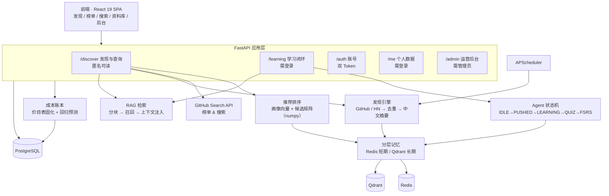

### 一条真实请求的路径

```
用户打开首页
  → GET /discover/news
      → 匿名则从知识库随机抽样；已登录则加载兴趣画像
      → 候选池（进程内缓存 6 MB，120s TTL）→ numpy 矩阵乘算相似度
      → 返回卡片 + recommend_score + recommend_reason
  → 卡片点「查看解读」→ GET /discover/cards/{id}/digest
      → 分块检索命中原文 → LLM 生成带引用的中文解读
  → 卡片点「收藏」→ POST /me/bookmarks/{id}
```

---

## 功能详解

### 1. 发现：推荐流

`GET /discover/news?limit=3&offset=0`

数据源按可用性降级：`knowledge_base`（Qdrant）→ `github`（Redis 缓存）→ `sample`（内置示例）。响应里的 `source` 字段直接说明本次数据来自哪一级。

已登录时走个性化排序（`src/services/recommend.py`）：

1. 加载兴趣画像向量（Redis，半衰期 14 天的加权衰减）
2. 候选池进程内缓存：payload + 行归一化矩阵（500×1536 float64 ≈ 6 MB）
3. `matrix @ profile` 一次算出全部相似度，`argsort(kind="stable")` 对齐 Python 稳定排序
4. 附 `recommend_score` 与 `recommend_reason`（例如「与你在 Rust 与存储方向的历史兴趣接近」）

> 📸 资讯卡片流 —— 标题、中文摘要、标签、星数均由抓取链路真实产出
>
> 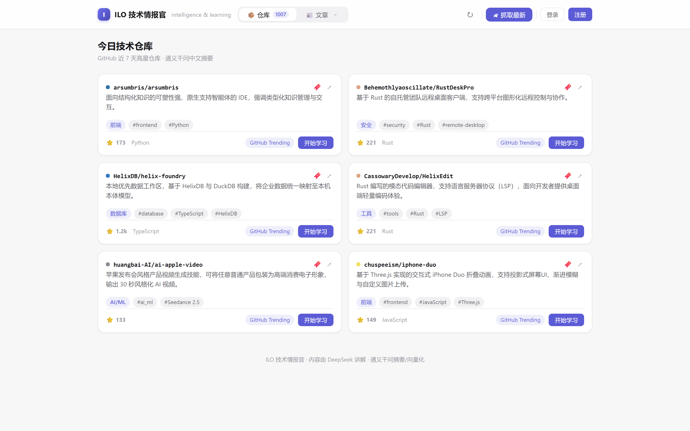

> 📸 抓取进度 —— 点「抓取最新」后进入阶段提示，此刻正在用通义千问批量提炼中文摘要
>
> 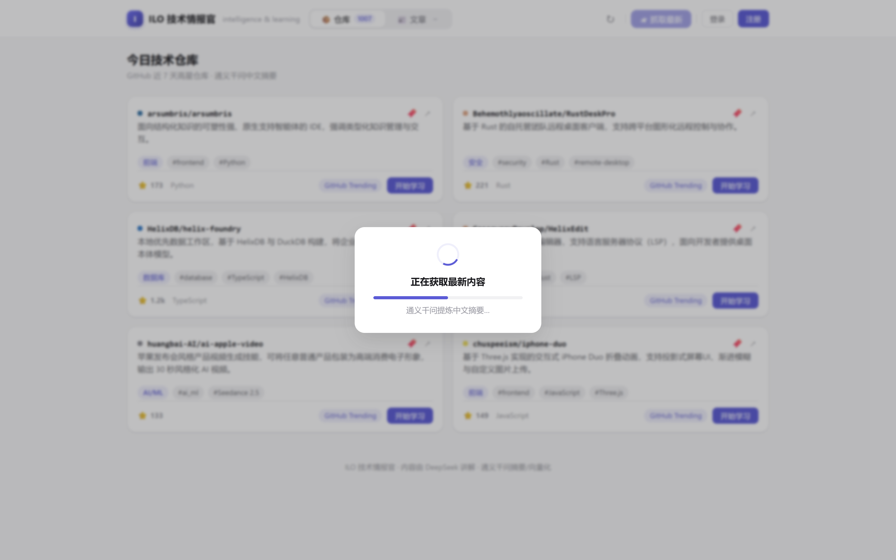

写入路径是异步任务：`POST /discover/refresh` 立即返回 `task_id`，前端轮询 `GET /discover/tasks/{task_id}` 拿阶段进度，不会把 50 条摘要的 95 秒压在一个 HTTP 请求里。

### 2. 查询：GitHub 新星榜

`GET /discover/rankings?window=week&language=rust&limit=20`

GitHub 官方**没有**「本周涨星」这类端点，只有 Search API。所以榜单口径是实打实算出来的：

```
q = created:>{7天前} archived:false [language:Rust]
sort = stars
stars_per_day = stars / 存活小时数 × 24
```

GitHub 的 Search API 只能按累计星数排，所以取回数据后要按 `stars_per_day` 二次排序：
周窗口里「1 天龄 500 星」（500/天）比「7 天龄 3000 星」（429/天）更热，只按累计星数排会把它压到后面，
`rank` 也就不再代表「本周最热」，而是「谁创建得早谁靠前」。重排用稳定排序，同分保持 GitHub 原顺序。

四级降级链，响应 `source` 字段标注来源：

| 顺序 | 数据源 | 说明 |
|---|---|---|
| 1 | 新鲜缓存（30 min） | 命中即秒回 |
| 2 | GitHub Search API | 固定抓 50 条再切片，缓存键不含 limit |
| 3 | 过期缓存（6 h） | 限流 / 5xx / 断网时兜底 |
| 4 | 知识库快照 | 已解读过的仓库按星数排 |

> 📸 新星榜 —— 本周 · 全部语言。注意第 1 名 573 星（约 1.1k/天）排在第 2 名 4.3k 星（859/天）之前：
> 榜单按日均涨星排，不按累计星数，否则新项目永远上不了榜
>
> 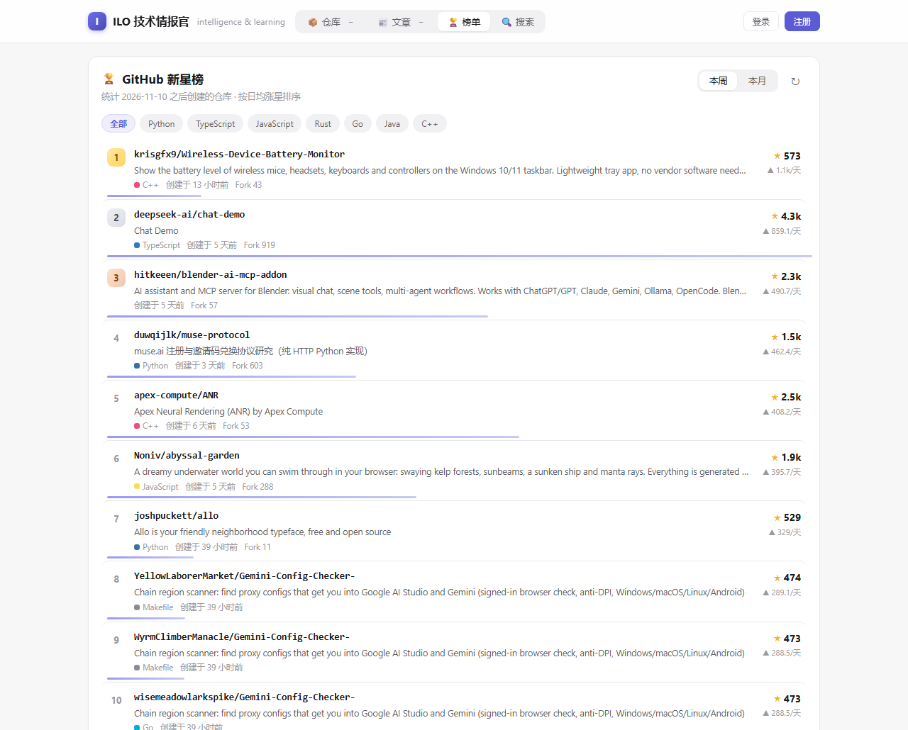

### 3. 查询：关键词搜索

`GET /discover/search?q=vector database&language=python&min_stars=1000&sort=stars`

与榜单共用同一套缓存与降级框架，但有四处刻意的差异：

| 决策 | 原因 |
|---|---|
| 缓存键用 SHA1 哈希 | 搜索的键由用户输入决定，数量和字符集都不可控 |
| 限流 120 次/小时（榜单 240） | 它是唯一「换个词就穿透缓存」的端点，而 GitHub Search API 未认证只有 10 次/分钟 |
| 不做输入即搜 | 每敲一个字打一次 GitHub，一句话就烧完配额；回车或点按钮才提交 |
| 兜底只返回真命中的本地结果 | 榜单兜底可以「全库按星排」，搜索不行——那是用语义不同的答案冒充答案，宁可为空 |

支持 GitHub 原生限定符（`topic:llm`、`language:rust`），这些是特性不是注入，不做过滤。查询串被 GitHub 422 拒绝时直接报错，不端缓存糊弄。

> 📸 仓库搜索 —— `vector database` 命中约 1.5 万仓库，语言与星数门槛可叠加；
> 标题行直接给出结果总量与数据来源，页脚露出实际下发的检索串
>
> 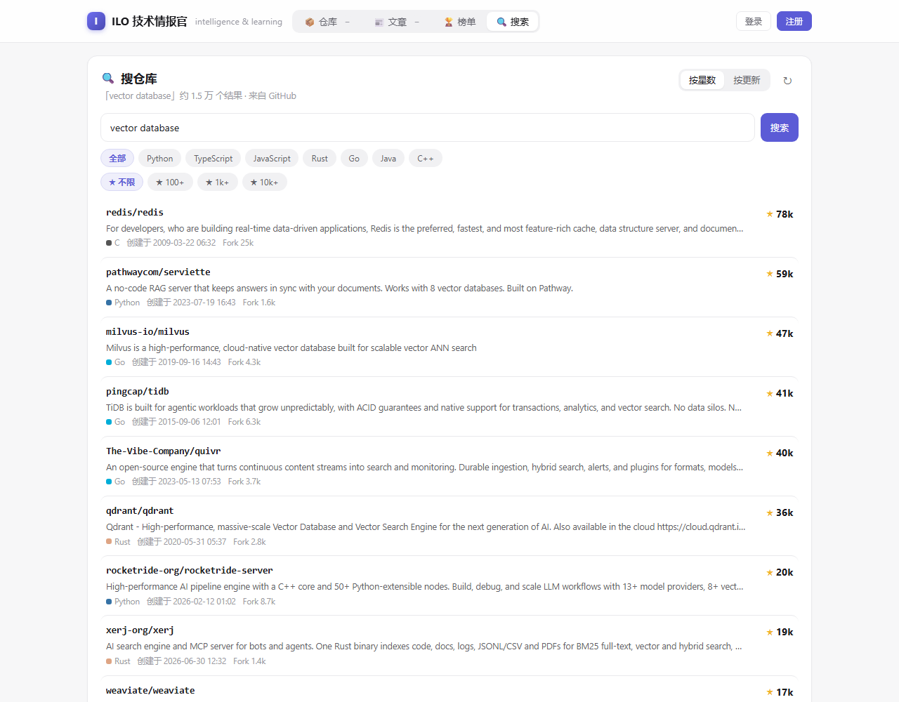

### 4. 解读与溯源

| 端点 | 权限 | 作用 |
|---|---|---|
| `GET /discover/cards/{id}/content` | 匿名 | 原文内容（仓库 README / 文章正文） |
| `GET /discover/cards/{id}/provenance` | 匿名 | 数据来源与抓取时间，可回原文核对 |
| `GET /discover/cards/{id}/digest` | 需登录 | LLM 生成的中文解读（带引用标记） |

解读不是让模型自由发挥：RAG 把原文分块入库，提问时召回相关块注入上下文（默认 1800 tokens），超出资料边界时明确回答「资料里没有」，而不是编一个像样的答案。

> 📸 AI 讲解对话 —— 多轮追问的真实回答；文末「资料里没有」是检索边界下的诚实说明
>
> 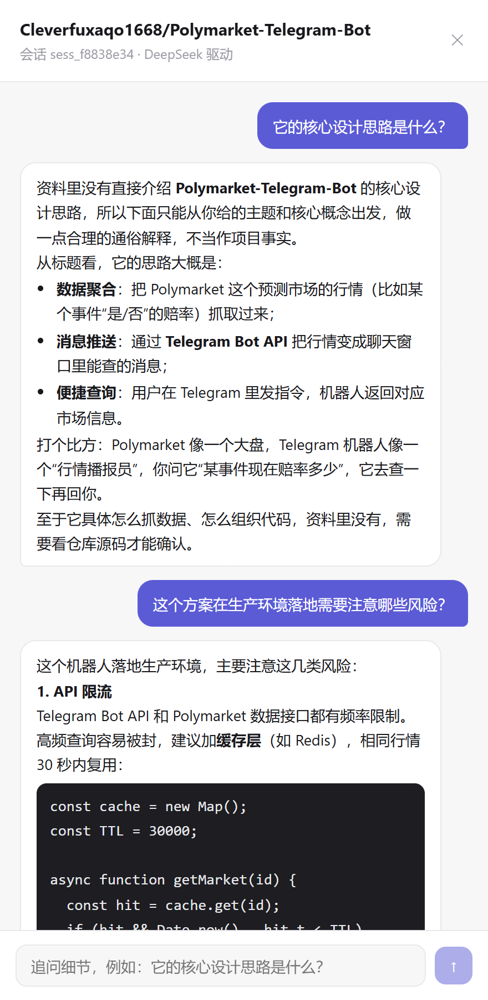

### 5. 延伸：相似项目推荐

`GET /discover/cards/{id}/similar?limit=5`

阅读抽屉底部的折叠条，按**当前卡片的入库向量**在知识库里查近邻。它回答的是「看完这个，接着该看什么」——榜单和搜索都是「主动找」，这一条是「顺路带你去下一个」。

实现上和首页个性化排序刻意用了两套机制：

| 决策 | 原因 |
|---|---|
| 走 Qdrant 原生 HNSW 检索，不用候选池 | 候选池是给首页排序用的固定 500 条快照，库里超出部分**永远召回不到**；相似推荐要的是「全库最像的几条」 |
| 阈值下推给 Qdrant（`score_threshold`） | 捞满再在客户端丢，最终很可能只剩两三条，且浪费了召回名额 |
| 同类型召回（仓库只找仓库） | 文章混进来对「接着看哪个项目」没有帮助 |
| 无结果就整块隐藏，不凑数 | 推荐里混进不相关项目比留白更伤信任——点进去发现无关，就再也不会点第二次 |

阈值不是拍脑袋定的：拿库里 32 张真实卡片重新 embedding 后统计了 496 个配对——**同方向**配对中位数 0.31 / p90 0.47，**跨方向**中位数 0.22 / p99 0.49。取 0.50 意味着过滤掉 99% 的跨方向配对。同时排序层对「共享技术概念」和「同方向」有极小的加分（各 0.02 / 0.03，封顶 0.08），只调整本来就接近的几条的先后，无法把差得远的顶上来。

理由文案讲的是**两者的关系**而不是候选自己的属性：共享概念优先（且会自动剔除「Python」这类实现语言——库里几乎每个 Python 项目都共享它，写进理由只会显得是凑的），其次「同为 X 方向」，最后才是「与当前项目语义相近」。

点任意一条会直接在**同一个抽屉里换上那张卡片**（重置会话、加载它的原文），可以 A → B → C 一路看下去，不必关掉抽屉回首页重新找。

> 📸 相似项目 —— 读完「perch」的 README，抽屉底部「相似项目 5 个」展开：每条给理由 + 相似度
>
> 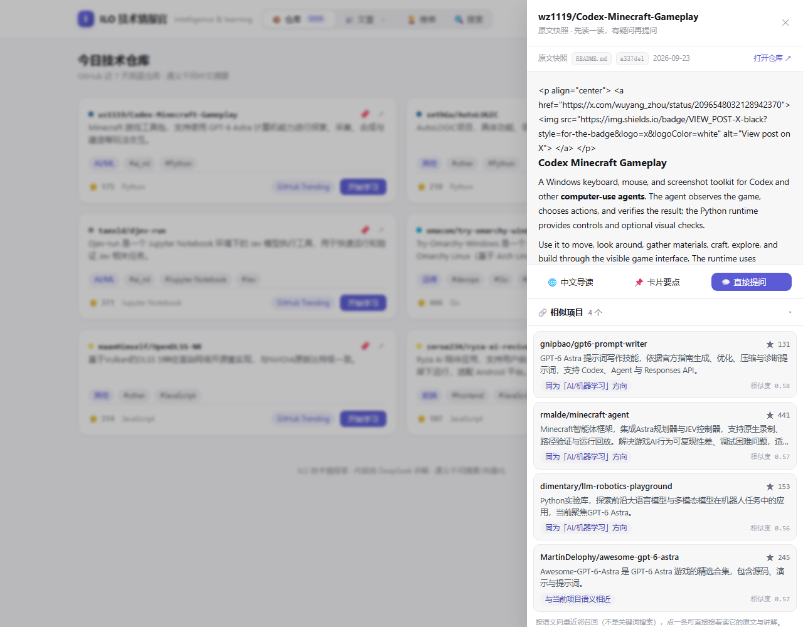

### 6. 收藏与资料库

`/me/bookmarks` 增删查、`/me/sessions` 学习历史、`/me/activities` 行为记录、`/me/export` 全量数据导出（JSON）。`user_id` 一律取自 access token 的 `sub`，请求体里的 user_id 不被信任。

### 7. 成本账本（运营视角）

LLM 调用最容易被「先做功能、后发现账单」坑掉，所以每次调用都记账：

- **金额在写入时固化**：按当时的价目表算好存进 `llm_usage.cost_cny`，之后调价不会改写历史
- **token 三级取值**：`usage_metadata` → `response_metadata.token_usage` → 字符估算（估算结果打 `tokens_estimated` 标记）
- **模型前缀最长匹配**：`deepseek-chat` / `deepseek-reasoner` 各自命中自己的价格行
- **预测**：近 14 天日花费做最小二乘线性回归，外推 7 天，输出斜率、R²、置信档位；`LLM_MONTHLY_BUDGET_CNY` 作为预算线

前端 `/admin` 的成本面板把「今天花了多少 / 照这个趋势月底多少 / 预算还能撑几天」讲清；预算充足时不说「还能撑 74997 天」这种荒谬文案，而是直接给「预算不构成约束」。

### 8. 账号与安全

| 机制 | 实现 |
|---|---|
| Token 分工 | access（30 min）只存前端内存；refresh（14 天）只走 `httpOnly; SameSite=Lax; Path=/api/v1/auth` Cookie |
| refresh 轮换 | 每次刷新换发新 token；旧 token 再用触发 reuse 检测，宽限窗内视为多标签页并发，超窗判定盗用并撤销全部会话 |
| 限流 | 注册 5/时·IP、登录 20/15min·IP + 10/15min·账号、搜索 120/时、学习对话 60/时……（Redis 固定窗口） |
| 登录锁定 | 账号维度计数，阈值后统一话术「登录尝试过于频繁」，不暴露账号是否存在 |
| 人机校验 | VAPTCHA V4，注册 / 找回强制，登录仅在已有失败记录时要求 |
| 密码策略 | NIST SP 800-63B 口径：8–72 字节 + 弱密码黑名单 + 与用户名重合即拒 |
| 隐私 | IP 落库前用 `IP_HASH_SECRET` 做 HMAC-SHA256，不可反查；未配置则不记录 |

改密 / 注销 / 手动下线后会话写入 Redis 黑名单，access token 立即失效。账号注销有 15 天冷静期，期内可撤销。

### 9. 学习闭环（后端实验性）

状态机 `IDLE → PUSHED → LEARNING → QUIZ → FSRS_UPDATE → COMPLETED`，接口齐全：

```
POST /learning/session   建立会话（上下文写 Redis，重启不丢）
POST /learning/chat      RAG 增强的多轮讲解
POST /learning/response  用户响应 → 讲解 + 生成测验
POST /learning/quiz      提交答案 → 评分 → 映射 FSRS 评级
POST /learning/complete  归档 → 计算下次复习间隔
```

得分映射评级：`≥0.8 → 4`、`≥0.5 → 3`、`≥0.2 → 2`、其余 `1`，评级驱动 FSRS v2 的 stability 与下次间隔。

**前端只做到讲解对话，测验与复习界面未实现**，目前通过 `/docs` 演示。这是一个明确的待补项，不当作已完成能力宣传。

> 📸 会话创建与上下文 —— 抬头是会话号与驱动模型，刷新页面后由服务端恢复
>
> 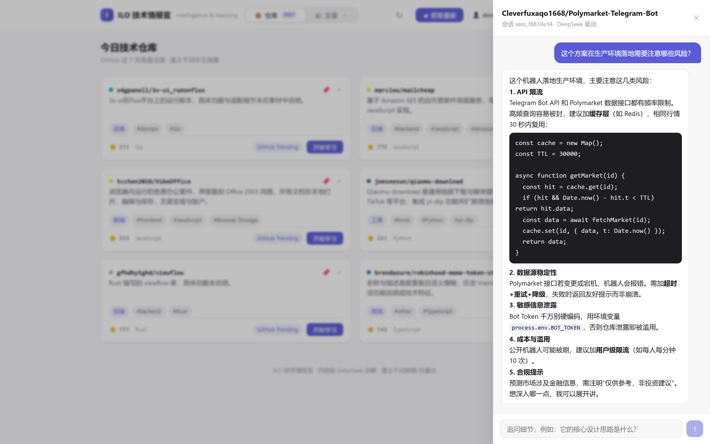

> 📸 Swagger 里真实调用 `/learning/quiz` —— 200 响应含逐题判定与 FSRS 复习间隔，证明后端链路完整
>
> 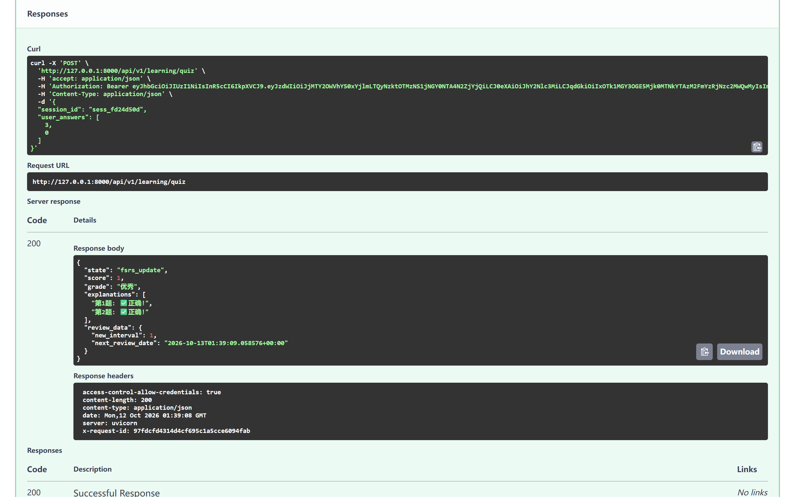

> 📸 `/learning/complete` —— 返回最终得分、评级与下次复习日期
>
> 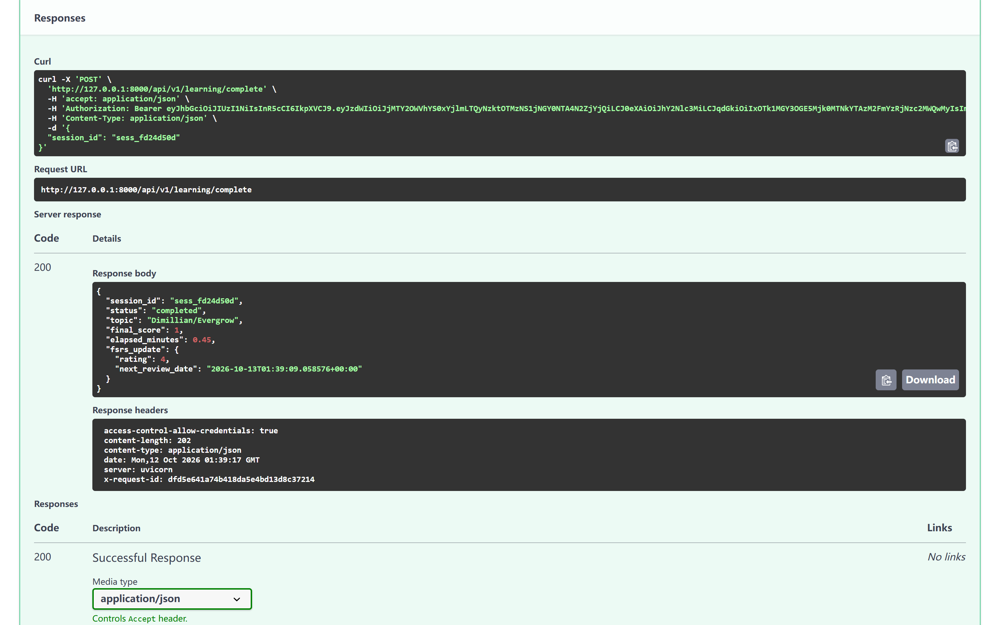

> 📸 一次完整运行的后端日志 —— LLM 初始化 → 建会话 → 讲解 → 评分 → 归档，
> 其中 `rag_chat_injected refs=3` 是检索资料真实注入对话的证据
>
> 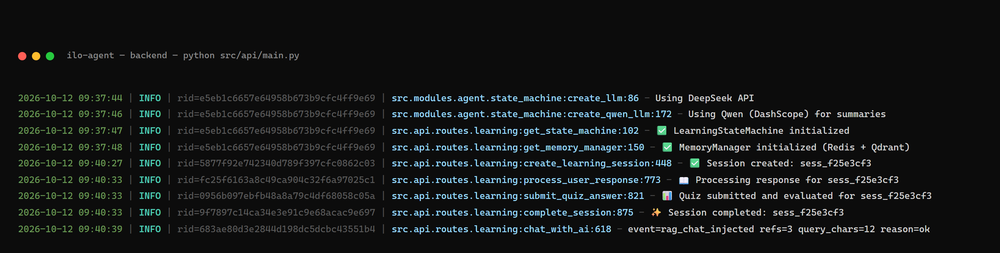

---

## API 一览

共 50 个业务端点（另有 `/health`、`/api/v1/info` 两个系统端点，以及 FastAPI 自带的 `/docs`、`/openapi.json`），全部带 `response_model`，错误统一为 `{code, message, detail}`。

| 分组 | 端点 |
|---|---|
| `/api/v1/discover` | `GET news` `GET articles` `POST refresh` `POST refresh-articles` `GET tasks/{id}` `GET rankings` `GET search` `GET trending` `GET by-tag/{tag}` `GET cards/{id}/content` `GET cards/{id}/provenance` `GET cards/{id}/digest` `GET cards/{id}/similar` |
| `/api/v1/auth` | `POST register` `POST login` `POST refresh` `POST logout` `GET captcha` `POST password/forgot` `POST password/reset` `POST password/change` `POST account/delete` `POST account/delete/cancel` `GET sessions` `DELETE sessions/{id}` `DELETE sessions` `POST email/confirm` `POST email/resend` `GET me` |
| `/api/v1/me` | `GET profile` `GET bookmarks` `POST bookmarks/{id}` `DELETE bookmarks/{id}` `GET sessions` `GET sessions/{id}` `GET activities` `GET export` |
| `/api/v1/admin` | `GET features` `PATCH features/{key}` `GET users` `PATCH users/{id}/role` `GET whoami` `GET llm/usage` |
| `/api/v1/learning` | `POST session` `POST push` `POST chat` `POST response` `POST quiz` `POST complete` `GET health` |
| 系统 | `GET /health` `GET /api/v1/info` `GET /docs` `GET /openapi.json` |

前端类型由 `npm run gen:api` 从 `/openapi.json` 生成到 `frontend/src/shared/api/schema.d.ts`，手写类型是被禁止的——这是保证前后端不漂移的唯一可靠方式。

> 📸 Swagger 全量接口 —— 右上角 `Authorize` 填入 access token 后可直接在线调试受保护接口
>
> 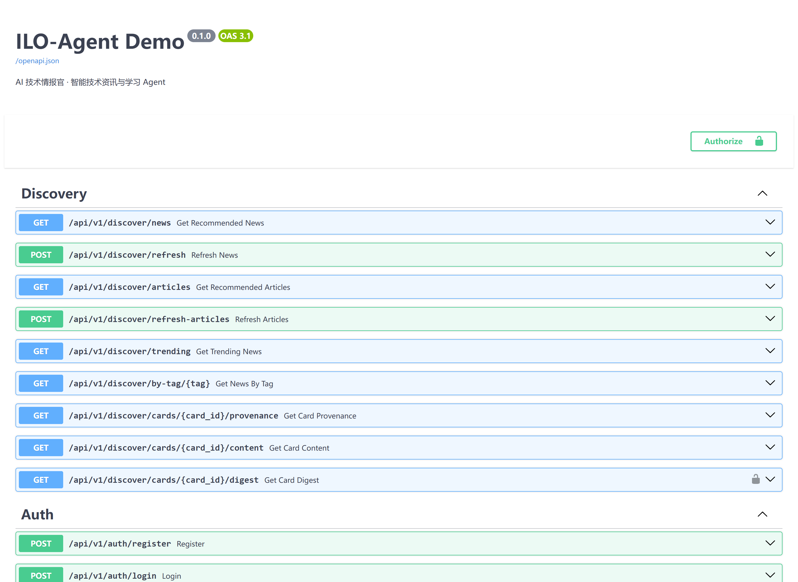

---

## 项目结构

```
ilo-agent-demo/
├── backend/
│   ├── src/
│   │   ├── api/
│   │   │   ├── main.py              # 应用装配、SPA 同源托管、预热调度
│   │   │   ├── deps.py              # 认证依赖（CurrentUser / OptionalUser / 管理员）
│   │   │   └── routes/              # discover / auth / learning / me / admin
│   │   ├── core/                    # 横切关注点
│   │   │   ├── config.py            # pydantic-settings，路径锚定 BACKEND_ROOT
│   │   │   ├── security.py          # JWT、bcrypt、refresh 轮换
│   │   │   ├── rate_limit.py        # 规则表 + 装饰器（Redis 固定窗口）
│   │   │   ├── errors.py            # 统一错误契约与全局处理器
│   │   │   ├── pricing.py           # LLM 价目表（前缀最长匹配）
│   │   │   ├── roles.py             # 角色与权限位
│   │   │   ├── resilience.py        # 超时预算 + 重试
│   │   │   ├── circuit_breaker.py   # 熔断
│   │   │   ├── deadline.py          # 单请求总时间预算
│   │   │   └── db.py net.py redis_client.py password_policy.py username_policy.py
│   │   ├── models/                  # SQLAlchemy 2.0（用户、会话、收藏、成本、画像…）
│   │   ├── schemas/                 # 唯一契约源（Pydantic）
│   │   ├── services/                # 业务逻辑（推荐、成本、收藏、画像、任务、预热…）
│   │   └── modules/
│   │       ├── agent/               # 状态机、记忆、向量化、讲解与测验
│   │       ├── discovery/           # 抓取引擎、GitHub 榜单、知识库
│   │       └── rag/                 # 分块、分块存储、检索、上下文注入
│   ├── alembic/versions/            # 11 个迁移
│   ├── tests/                       # 37 个测试文件
│   ├── evals/                       # 检索与对话的评测集与判分脚本
│   ├── start_dev.py                 # 一键启动（依赖探测 → 前端 → 后端）
│   └── requirements.txt
├── frontend/
│   ├── scripts/                     # check-markdown-sanitize.mjs：HTML 白名单守卫
│   └── src/
│       ├── features/                # 按业务域切分，相互不 import
│       │   ├── discovery/           # 首页、卡片、榜单、搜索、工具栏
│       │   ├── learning/            # 学习抽屉、会话 hook
│       │   ├── auth/                # 登录注册、账号安全、设备管理
│       │   ├── library/             # 我的：收藏、历史、画像
│       │   ├── admin/               # 后台：Feature Flag、用户角色、成本面板
│       │   └── legal/               # 隐私政策、服务条款
│       ├── shared/                  # api 客户端、类型、hooks、格式化
│       └── routes.tsx               # 路由表 = 组合根（跨 feature 只在这里组装）
├── docs/images/                     # README 截图
├── Dockerfile                       # 两阶段：Node 构建前端 → 3.13 后端同源托管
├── docker-compose.yml               # api + Redis + Qdrant + PostgreSQL
├── docker/entrypoint.sh             # 等库就绪 → Alembic 迁移 → exec uvicorn
└── QUICKSTART.md                    # 建库、迁移、密钥的详细步骤
```

模块边界是硬约束：**features 之间零交叉依赖**，跨 feature 的组合一律写在 `routes.tsx` / `App.tsx`（如账号区以 `accountSlot` 插槽注入顶栏）。后端同理，导入前缀统一 `src.`——混用 `core.` 与 `src.core.` 会把同一文件加载成两个模块，导致异常处理器静默失配。

---

## 关键设计决策

| 决策点 | 方案与取舍 |
|---|---|
| 记忆分层 | 对比 Mem0（外部服务、依赖网络）后自建：Redis 存短期会话与画像，Qdrant 存长期向量，保留接入 Mem0 的字段 |
| LLM 抽象 | `create_llm()` 按环境变量探测 Provider（DeepSeek → OpenAI → 自定义），无 Key 优雅降级 |
| 模型分工 | 交互讲解用 DeepSeek（快、便宜），批量中文摘要用通义千问；摘要不可用回退英文原文 |
| 向量降级 | 真实 Embedding 优先（多 Provider），仅在 API 不可用时用占位向量兜底，保证写库不中断 |
| 契约单一 | 后端 `schemas/` 是唯一真相，前端类型从 OpenAPI 生成；手写类型等于制造第二个真相 |
| 榜单口径 | 用 `stars_per_day` 而非累计星数，否则新项目永远上不了榜 |
| 缓存键 | 榜单用可读键（24 个组合），搜索用 SHA1（输入不可控）；过期缓存单独一个键，靠 TTL 自然接管 |
| 金额固化 | 成本在写入时按当时价目表算好存库，调价不改历史；否则账本随时会变，预测失去意义 |
| 首屏性能 | 候选池进程内缓存 + numpy 矩阵乘替换纯 Python 循环；`agent` 包 PEP 562 惰性导出，避免 import 就拖起 12 秒的重栈 |
| 单端口同源 | FastAPI 直接托管前端产物并做 SPA 回退，跨域与 Cookie 问题一次性消失，部署只需一条隧道 |
| 错误契约 | `ILOException` + 全局处理器产出 `{code, message, detail}`，路由声明 `response_model` 让错误信封进入 OpenAPI |
| 第三方 HTML | 原文快照要渲染 README 的内联 HTML（居中块、徽章、折叠段），否则标签会被当纯文本吐出来；所以 `rehype-raw` 必须紧跟 `rehype-sanitize`（GitHub 同款白名单，`script`/`style` 整块 strip，`on*` 与 `javascript:` 清除），且只在文本里真的出现块级标签时才挂——否则 `vector<int>` 这类泛型写法会被当成未知标签删掉。`npm run check:sanitize` 守住这两条 |

---

## 性能

| 指标 | 优化前 | 当前 | 做法 |
|---|---|---|---|
| `GET /discover/news`（稳态） | 1.26 s | **42–70 ms** | 候选池进程内缓存 + numpy 矩阵乘 |
| 重启后首个请求 | 21 s | **1.49 s** | PEP 562 惰性导出 + 两段式预热 |
| 创建学习会话 | — | ~800 ms | 含 LLM 初始化，属预期开销 |
| 提交测验 | — | ~100 ms | 纯计算，无 IO |

定位过程用 `cProfile` 逐段打点，三处瓶颈分别是 `candidate_points`（450 ms）、`rank_candidates` 的纯 Python 循环（674 ms）、以及 `import agent` 触发的 `langchain_openai → transformers → torch` 连锁导入（15.2 s）。回归测试在 `tests/test_personalization_perf.py`。

---

## 测试

```bash
cd backend
python -m pytest                             # 614 项通过（另有 2 项 eval 质量门禁默认 deselect）
python -m pytest tests/test_search.py -v     # 单模块
python -m pytest -m eval                     # 只跑 eval 门禁（会真实调用 LLM，花钱）
```

`pytest.ini` 里的 `addopts = -m "not eval"` 把 `evals/` 的 LLM-as-judge 评测挡在默认回归之外——它是质量门禁，不是单元测试，不该每次跑测试都产生账单。

614 是本机 PostgreSQL 已起、Redis / Qdrant 已起时的数字；走真实库的几个文件（`test_auth.py`、`test_authz.py`、`test_admin_flags.py` 等）在 `DATABASE_URL` 不可用时整文件 `skipif`，数量会相应变少。

37 个测试文件按关注点划分，不是按文件划分：

| 关注点 | 代表用例 |
|---|---|
| 契约完整性 | `test_api_contract.py`（响应 schema、错误信封、权限边界） |
| 认证与授权 | `test_auth.py` `test_auth_hardening.py` `test_authz.py` `test_session_security.py` |
| 发现与查询 | `test_ranking.py` `test_search.py` `test_collect_tasks.py` |
| 推荐与检索 | `test_recommend_ranking.py` `test_retriever.py` `test_interest_profile.py` |
| 成本 | `test_cost_math.py` `test_llm_cost.py` |
| 稳定性 | `test_circuit_breaker.py` `test_resilience.py` `test_deadline.py` `test_timeout_budget.py` |
| 性能回归 | `test_personalization_perf.py` `test_async_no_blocking_io.py` |

`test_async_no_blocking_io.py` 专门守「异步路由里不许出现同步阻塞调用」，`test_timeout_budget.py` 顺带守住「每个配置项都必须在 `.env.example` 里出现」——这条守卫在我漏写配置文档时真的报过错。

前端没有单测，只有 `tsc -b` 类型检查、`npm run build`，以及 `npm run check:sanitize`——它跑一遍 Markdown 渲染管线，确认 README 里的内联 HTML 能被渲染、而 `script` / `on*` / `javascript:` 被清掉；界面用手动截图核对（桌面 1280 / 移动 390 两档）。

---

## 部署

### 单端口同源

```bash
SERVE_FRONTEND=true            # 写进 backend/.env，或作为环境变量
FRONTEND_DIST=                 # 留空则默认 <项目根>/frontend/dist
```

挂载顺序有讲究：API 路由先注册，静态兜底最后挂 `/`。`SPAStaticFiles` 做两件保护——`api/` 开头的 404 不被 SPA 回退吞掉，缺失的 `.js` / `.css` 返回 404 而不是 `index.html`。

> Windows 上 Starlette 传入的 path 是反斜杠形式（`api\v1\x`），直接 `startswith("api/")` 会静默失配，判断前必须先归一化分隔符。

### 内网穿透

**只暴露 8000，不要把 5173 也穿透出去。** 两条隧道的子域互为跨站，`SameSite=Lax` 的 refresh Cookie 不会被发送，表现就是「登录成功、一刷新掉登录」。

| 工具 | 域名 | 国内访问 | 代价 |
|---|---|---|---|
| cpolar | 免费随机二级域名，24h 重置 | 好 | 注册即可，演示首选 |
| cloudflared | `trycloudflare.com` 随机 | 一般 | 无需账号，一条命令 |
| frp + 轻量云 | 自有域名，可常驻 | 最好 | 需要 VPS + 备案域名 |

```bash
cpolar.exe authtoken <token>
cpolar.exe http 8000        # https://xxxx.r3.cpolar.cn -> http://localhost:8000
```

演示前 checklist：`COOKIE_SECURE=true`（HTTPS 下必须）→ 手机 4G 打开隧道域名 → 登录、刷新、进会话，确认不掉登录 → 打开 `RATE_LIMIT_ENABLED` 与 `CAPTCHA_PROVIDER`，公开链接会被爬虫刷 LLM 成本。

`src/core/net.py` 只在**直连方是可信代理**时才采信 `X-Forwarded-For` 首地址（白名单 `TRUSTED_PROXY_IPS`，默认 `127.0.0.1,::1`），这样穿透后限流按真实访客 IP 计算，同时公网直连者换个请求头也换不到新计数桶。若前面还挂了 nginx 或容器代理，要把那一跳的地址加进白名单，否则 XFF 会被忽略、全站共用一个桶。

### 容器（一条命令起整套）

```bash
cp backend/.env.example backend/.env   # 至少填 JWT_SECRET 与 LLM Key；DATABASE_URL 会被 compose 覆盖为容器地址
docker compose up -d --build
# 打开 http://localhost:8000 —— 前端与 API 同源，对外只有这一个端口
```

镜像是两阶段构建：`node:22-alpine` 跑 `npm ci && npm run build`，`python:3.13-slim` 装后端依赖并托管上一步的 `dist/`。compose 编排四个服务：

| 服务 | 作用 | 端口暴露 |
|---|---|---|
| `api` | 前端 + FastAPI 同源 | `${API_PORT:-8000}`，唯一对外端口 |
| `redis` | 会话 / 缓存 / 限流 | 仅 `127.0.0.1:6379`（本机开发仍可探活） |
| `qdrant` | 向量记忆 | 仅 `127.0.0.1:6333` |
| `postgres` | 用户 / 收藏 / 成本台账 | 不映射宿主（本机已有实例，避免 5432 冲突） |

`docker/entrypoint.sh` 会先等 PostgreSQL 可连，跑 `alembic upgrade head`，再 `exec uvicorn`——不用手动建表。容器网络里 `TRUSTED_PROXY_IPS` 放行了 Docker 网桥网段（`172.16.0.0/12`），保证隧道注入的 XFF 仍用于限流分桶。

⚠️ 生产上线前必须改三处：compose 里的 `POSTGRES_PASSWORD` 与 `DATABASE_URL` 口令（当前是开发默认值）、`JWT_SECRET`（至少 32 字节）、`COOKIE_SECURE=true`（HTTPS）。此外 compose 用 `env_file` 可选加载 `backend/.env` 带入真实 Key，文件不存在也能以降级模式启动。

> 构建环境提示：若 Docker daemon 配了失效的代理，`docker compose build` 会在拉基础镜像阶段失败（报 `app settings HTTPS proxy ... refused`）。此时需要在 Docker Desktop 设置里修正代理或配置国内镜像源——这是本机环境问题，与镜像本身无关。

---

## 常见问题

**Q：Redis / Qdrant / PostgreSQL 哪些是必须的？**
PostgreSQL 必需（账号、收藏、会话、成本台账）。Redis 缺失时会话落内存 Dict，功能可用但不能多进程。Qdrant 缺失时回退本地示例数据与关键词检索。

**Q：没有 LLM API Key 能跑吗？**
能。`create_llm()` 探测不到 Key 就走内置降级回答，接口不报错，只是讲解质量退化。

**Q：为什么 Python 3.13 而不是 3.11？**
开发机就是 3.13。代价是 `feedparser` 依赖的 `cgi` 模块在 3.13 被移除，所以那个 RSS 引擎整个删掉了，抓取链路统一改用 httpx 直接请求 API。

**Q：前端为什么禁止手写 API 类型？**
手写类型等于维护第二个契约真相。后端改字段、前端类型不动，编译期不报错，运行时才炸。生成式类型把这个可能性直接消灭。

**Q：为什么榜单和搜索不用同一个端点？**
参数形态、缓存策略、限流配额、兜底语义都不同。合成一个端点会让每一层都要写 `if is_search` 分支。

---

## 路线图

**近期**
- [ ] 前端补齐「测验 → FSRS 复习计划」界面，打通学习闭环
- [ ] 前端代码分割：当前单 chunk 793 KB（gzip 239 KB），vite 报超 500 KB 警告

**中期**
- [ ] 检索质量评测纳入 CI：`evals/` 已有数据集与判分脚本，缺自动门禁
- [ ] 榜单与搜索结果的本地沉淀：命中的仓库可一键入库并生成解读
- [ ] 推送通道扩展（邮件摘要 / Telegram Bot）

**长期**
- [ ] 接入 Mem0 做记忆方案对比验证
- [ ] 团队知识库：多人共享收藏与解读笔记

---

## License

MIT

## 作者

曾煜 · [GitHub](https://github.com/LOve-LaQ/ILO-Agent) · [Gitee](https://gitee.com/zeng-yu-42/ilo-agent)
